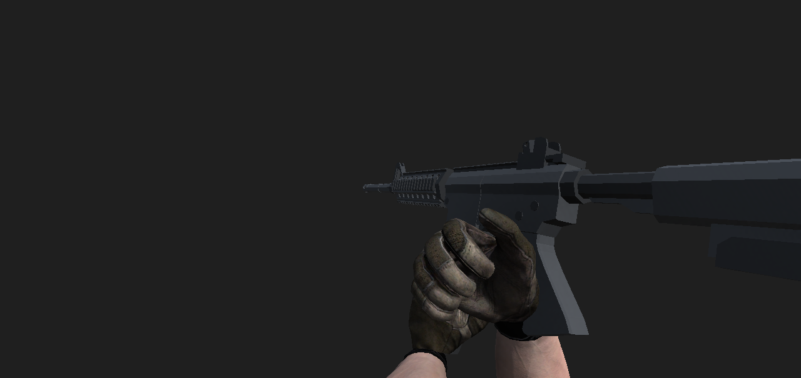
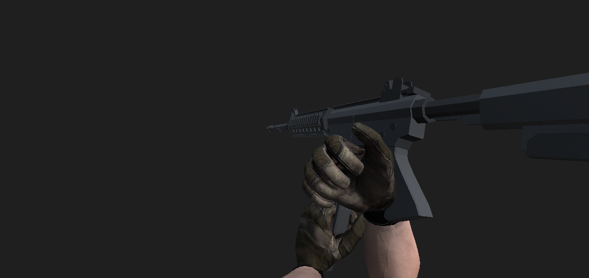

# 장전 탄창 분리 구간의 가독성 (#188)

탄창을 빼는 구간에서 왼손과 탄창이 기존 지지 손에 가려져 동작을 알아보기 어려웠습니다. 기존 추출 곡선을 공유하고 탄창 최대 이동을4cm에서10cm로 늘렸습니다. 같은 구간에 표시용 무기를 최대4cm 더 들어 올려 탄창이 화면 아래로 빠지는 것을 줄입니다. 시작·재삽입의 추가 높이는0이며 기존 손 복귀·오른손 그립·손가락 자세·조준/네트워크 판정은 변경하지 않았습니다.

## 같은 카메라의 분리 구간

별도 Windows QA Editor의 실제 모델을 같은 카메라·1280×605/FOV60·진행률0.4375에서 렌더한 원본 PNG입니다. 장갑은 현재 포즈의 CPU-baked mesh이며 실제 GPU skin·게임 조명과의 동등성을 뜻하지 않습니다.

변경 전:

변경 후:

## 실제 확인

- 전후 각3구간(reach/pull/insert)의 카메라 위치·회전·행렬·projection·near/far·해상도가 정확히 같습니다. reach/insert는 원본 PNG SHA도 전후 동일했고 pull에서 분리된 탄창이 더 보이는 것을 직접 확인했습니다. 탄창826개 vertex 중심은 세 표본 모두 양의 깊이와 화면 범위 안입니다. 전체 pixel 가림·피부 접촉 검사와 구분합니다.
- 실제 공유 곡선16조건은 NaN/무한대·범위 밖·시작/추출/삽입/끝을 포함합니다. 진행률0.97/1에서 손·탄창 가중치0, 세 포즈의 제품 목표 대비 손목 잔차0.5mm 미만과 도달 여유를 확인했습니다. 자연 장전의 시간 변화·즉시 발사를 측정한 것은 아닙니다.
- CompileOnly·Disabled·실제 실행은 진단0입니다. 실제 helper마다 render3, clone load/unload1/1·reset3·material9/9, mesh/skin/light/RT/texture 각1/1·snapshot2/2·buffer4/4 정리를 기록했습니다. 오류0, 원래 material/source/scene 상태를 보존했고 새 손가락 회전·별도 IK·시뮬레이션 상태 쓰기·Save는0입니다.
- 후속 Editor는 PID63324/시작 `2026-10-28T02:33:24.4039766Z`/Game MVID `3492ed7a-74c5-4692-8f6e-b188389abb05`의 batch/D3D11·worker1·non-Play 빈 clean scene 표본입니다. 보유 process handle로 `2026-10-28T02:39:57.963736Z` 실제 ExitCode0을 확인했습니다. 강제 종료·Save·종료 뒤 창 조회는0입니다.
- QA의 의도한 C#2개 적용 후 공개3,984개는 import·실행·정상 종료 뒤 새 준비 기준과 바이트가 같고 private6개는 부재/indexS입니다. 기존 QA 체크아웃에 현재 C#을 적용한 표본이며 최신 main 전체 clean 빌드가 아닙니다. Root의 기존 설정5개도 별도로 보존했습니다.

## 한계와 후속

Blue 세 구간/steady blend1의 정지 표본 가독성 개선입니다. 양 팀의 자연 장전·완전한 피부 접촉·모든 화면비/조준각·사망/리스폰/중단·Android 수용은 별도입니다. 공유 곡선과 단일 solve를 유지하며 #188/#166 전체는 열어 둡니다. 코드34 QA APK에는 이번 변경이 미포함이고 새 Android 버전 예약은 없습니다.

첫 helper는 빈 scene 이름 판정에서 clone/render 전에 차단됐습니다. 허용 이름만 별도 수정·검토한 새 revision/nonce로 전후 각3프레임을 실행했습니다. 종료 helper 첫 준비본의 PID 치환이 시간 상수를 바꾼 것을 실행 전 발견해 보존했고 실행하지 않았습니다. 수정한 별도 준비본만 소유 확인 후 정상 종료에 사용했습니다. 실패·미실행을 통과에 합산하지 않습니다.

외부 원문은 `D:/codex/validation/sudden-force-fps/20261028-work/`에 보존합니다.

| 근거 | SHA256 |
| --- | --- |
| 전 결과 `reload-grip-design01/revision04/actual-317521bc29c649e9b854ea3d86f878eb/result.public.json` | `15CE5DCDFB72BAC3EE72029F099A53C8C6C87E4B33D75516E3B53269BC0400D8` |
| 후 결과 `reload-grip-design01/revision05/actual-cf415f8e0b2b40d28a036718985d9cfb/result.public.json` | `5EB5270D81A4D2D848B6DE164AAFECFC217A9523E86EE6A4F85AF787D4340A82` |
| 비교 `reload-visibility-paired01/paired-observations.public.json` | `B6A5B5573ED7267C7F2CFA6367CF1E296E8D966FAE25AF81A632D9739B104F6E` |
| 소스 독립 검토 `reload-visibility-source-independent-review01/verification.public.json` | `BF71E7249EBDB196CFF14B5A00B198AF36B3742B99A7C397323832C38E85D241` |
| 정상 종료 `p11-visibility-normal-close01.public.json` | `061F7B1DC3BE53CDB13E4BD392905F56E0BD5B1D394D6C2D32D03F6620BDA818` |
| 종료 후 입력 `p11-visibility-after-close01.public.json` | `83058259AC611B9D5EDC389CB98F769A970F761C79648B986D91ECF3B9C5C5C6` |
