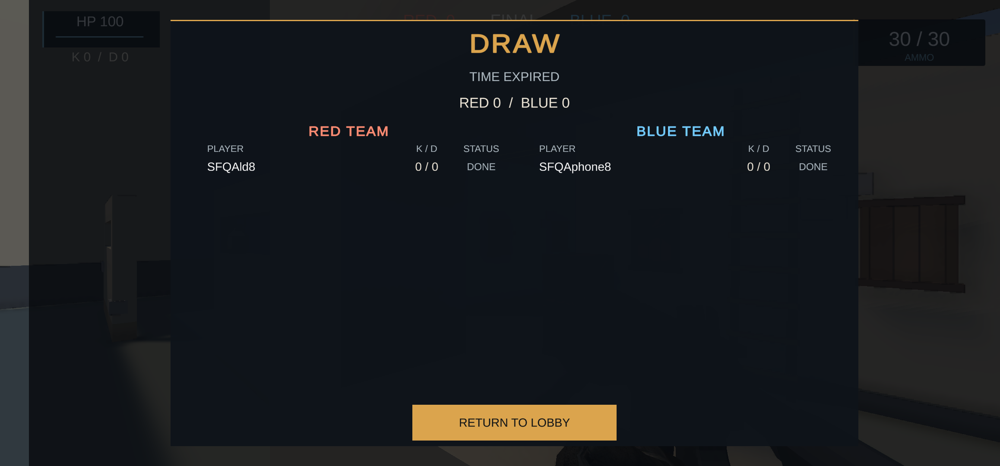
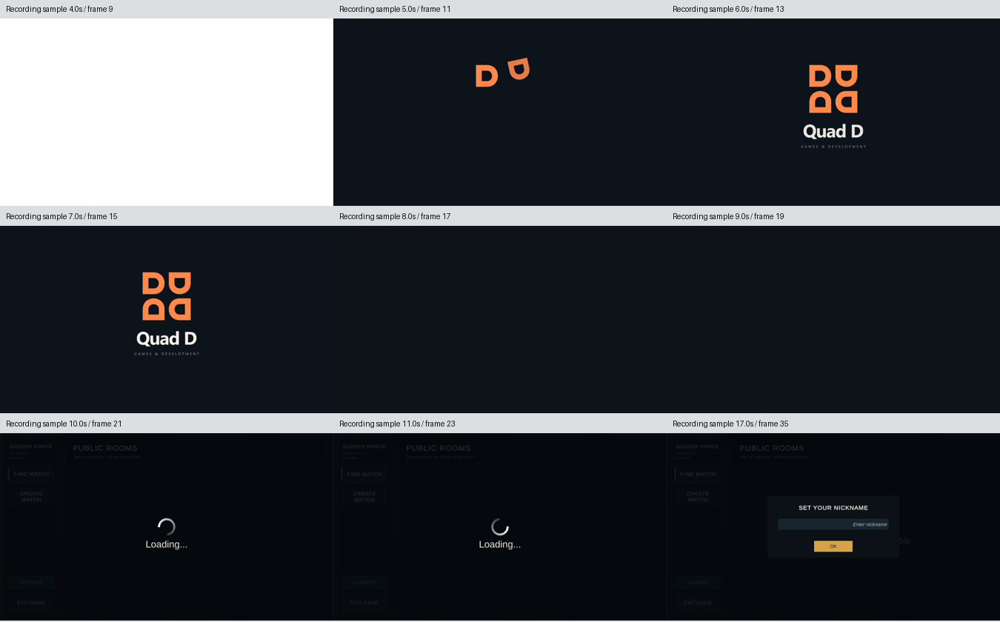

# QA1 인트로·입력 준비·PC 연동 후속 — 2026-11-08

관련 #347 / Draft PR348. 이 문서는 같은 날의 [휴대전화–LD 기본 경기](localqa-phone-ld-game-flow.md) 이후 관측을 기록합니다. QA1은 `com.AeDeong.SuddenForceFPS.localqa`의 `1.0.197-qa1`/code1이며 Play의 `1.0.196`/code34/release12와 별개입니다. 이번 문서로 기존 Draft 코드·전체 입력 검증을 수용하지 않습니다.

## 먼저 확인한 기본 경기

휴대전화와 LD가 반대 팀으로 Game에 들어가 5분 DRAW/0:0/TIME EXPIRED, 두 명 DONE, 양쪽 PUBLIC ROOMS 복귀까지 진행했습니다. 양쪽 탄약은 30→20→30을 관찰했습니다. 아래 이미지는 해당 기본 경기의 휴대전화 결과이며 후속 입력 시험의 결과가 아닙니다.

## LD cold 인트로 — case05

설치된 QA1을 LD index2에서 새로 시작하는 구간을 20초 제한으로 녹화했습니다. MP4는 784,383B/SHA256 `B564E00684918227C7F42E5B207AD26AD4D413236E9D9F8C5859E8F9AA9B3639`이며 remote hash·local size·컨테이너 표식을 확인했습니다. FFmpeg로 초당 2장씩 39장을 추출했고, 그중 9개 지정 표본을 직접 검토했습니다. 이 2fps는 영상 추출 간격이며 게임 FPS 측정값이 아닙니다.

명목 5초 표본에는 주황색 D 조립, 6·7초에는 완성 Quad D 로고, 8·9초에는 어두운 화면, 10·11초에는 로비 로딩, 17초에는 닉네임 화면이 보였습니다. 모든 프레임의 연속 재생·페이드 타이밍·Unity Splash의 존재나 원인·음성 청취는 확인하지 않았습니다.

녹화 viewport는 시작 시 세로 900×1600으로 고정돼 게임 가로 영역 주변에 검은 여백이 있습니다. 위 연락판은 검토한 게임 영역만 자른 것으로 실제 기기의 여백 결함을 증명하지 않습니다. 원본 영상·39개 프레임은 외부 검증 폴더에 보존합니다.

일반 Caller17 11회는 성공 6회, guard 실패 4회, 기대한 PID 부재 반환 1회입니다. 실패한 캡처 중 하나는 primary exit0 뒤 후속 guard 실패이므로 성공에 합산하지 않습니다. 별도 startup wrapper 4회는 녹화와 시작·stat·hash·cat을 수행해 모두 종료0이었으며 내부 Client 호출은 5회입니다. 게임 중지·HOME과 권한 회수 후 실제 반환은 13:33:18.271989 UTC로 원래 전체 기한 13:36:23.626479 안입니다.

독립 검토는 영상 해시와 지정 9개 표본의 제한된 로고·로비 흐름만 수용했습니다. 전체 인트로·실청·제품 코드 수용은 아닙니다.

## Native 입력 준비 — case06

게임 APK 99,942,564B/SHA256 `17FC62AD4A73E6B3221BD470E2D97AEB84AFCEB29AB2F20ADEAF56DA359C188F`와 helper 16,528B/SHA256 `31B7971E51B49C2814CCEACA7F77C98529E05E732DC372890AB331995B7C520E`를 양쪽 기기에서 각각 다시 읽어 일치시켰습니다. 설치·빌드·서명은 하지 않았습니다.

양쪽 Room 화면에서 같은 방명 `SFFQA1108N6`을 확인했고, 휴대전화 Room에는 RED `SFQAld8`/BLUE `SFQAphone8` 두 명이 보였습니다. READY·START 후 LD Game HUD의 HP100/AMMO30·30/04:48을 직접 확인했습니다. 이 회차의 휴대전화 Game 사진은 없어 양쪽 동시 Game 검증으로 확대하지 않습니다.

LD의 실제 게임 PID에서 `SFF_INPUT_QA` 첫 Availability 한 행을 받았습니다. seq1, av/rd2047, Android·mobile·focus·Game·valid·local·running·can1, err/overflow/ambiguity0입니다. 이는 QA recorder의 준비 관측이며 이동·사격 입력 수용이 아닙니다.

LD `single` 주입 요청은 Client.call 내부의 사전 시간 검사에서 `FULL_MUTATION_WINDOW_REQUIRED`로 거부됐습니다. 원 새 작업 종료까지 최소 25초가 남지 않아 소켓·기기 명령·입력 주입 전에 중단됐습니다. 여섯 native profile은 모두 미실행이며, 두 release order·held-life·사망/부활은 미수용입니다. 이 실패로 내부 20초 command window 결함이 재현됐다고 주장하지 않습니다.

Caller19 54회 중 53회는 종료0, 위 사전 거부 1회는 종료1입니다. 53회 성공 호출의 연결 시도 기록은 240개로, 입력 전 거부 소켓 7개를 닫고 새 연결 7개를 확인한 뒤 233개를 허용했습니다. 기기 명령 replay는0이며 새 연결 수와 성공한 게임 입력 수는 별개입니다.

첫 닉네임 시도에서 Android Back으로 확정 전에 키보드를 닫은 뒤 빈 입력·안내 팝업을 관찰했습니다. 정상 키보드 확인 버튼으로 재입력해 Room까지 진행했으며 제품 결함 원인은 확정하지 않았습니다. Root의 첫 계획 파일 작성도 지원되지 않는 PowerShell `Set-Content -NoClobber` 인자로 실패했고 파일·기기 쓰기0을 보존한 뒤 CreateNew로 별도 작성했습니다.

양쪽 게임 중지·HOME 4회는 모두 종료0입니다. 정리 뒤 PID 부재는 별도로 조회하지 않았습니다. 원창은 14:38:00.622893/new14:50:00.622893/full14:53:00.622893 UTC이며 실제 반환은 14:50:54.544653입니다. 같은 서버 세대·사용자 설정 두 값·호출 부재 확인과 공개 제어 및 private lease 회수는 Root 관측이며 독립 검토자의 새 OS 조회가 아닙니다.

## PC–휴대전화 연동 — Host07 실패

별도 headless Android Editor는 실제 ExitCode1로 끝났고 시험 결과는 `NORMAL_HOST_ROOM_RESULT / CreatingRoom / GuardFailure`였습니다. 메타데이터 일부 검사는 통과했지만 Game·START·실시간 보행 observer는0입니다. 정상 로비 복구만 관측했고 시험 내부의 원래 빈 Scene 복원은 실패했습니다.

SDK 자동 변경의 EDM 세 bool과 형식 변화를 전후 보존·분류한 뒤 원본을 복원했습니다. 공개 4,067개 복원 자료는 원래 full14:01:35.578937 UTC 전에 생성됐으나 최종 Git 메타데이터 확인이 timeout으로 실패했습니다. 후속 읽기 전용 감사에서 원본 일치와 시험 파일 8개·폴더 2개 부재, P13 clean을 확인했고 실제 전체 반환은14:04:38.641322로 약183초 늦었습니다. 복원·후속 감사와 기한 내 전체 성공을 구분합니다.

새 Host04 시험 코드는 `StartGame` Task 완료 후 실제 Room/Scene 준비를 별도로 기다리도록 수정하고 소스 검토를 마쳤습니다. 이 문서 시점에는 실제 실행0입니다. SDK 장면 로딩 NullReferenceException과 방 준비 실패의 인과는 미확정이며 제품 네트워크 코드를 추정만으로 고치지 않았습니다.

## 근거와 다음 작업

아래 경로는 로컬 `D:/codex/validation/sudden-force-fps/20261108-work/` 기준 공개 검증 자료입니다. 원시 로그·private lease·키·APK/영상 파일은 Git에 추가하지 않았습니다.

| 범위 | 공개 자료 | SHA256 |
|---|---|---|
| 기본 경기 독립 검토 | `device-case02-independent-review01/verification.public.json` | `2FD79B05AF92C2A8E3D1E5C0BB6600E7ACE52F4B07CDFD7C09B77B837588B46B` |
| LD 인트로 표본 독립 검토 | `cold05-actual-bounded-independent-review01/verification.public.json` | `A1E655D4693DA59AB9DC11332B723135381FC85853B17E3903926F15D4B4205B` |
| Native06 Root 관측 | `root-resume01/device-case06-bounded-observation.public.json` | `2295D194136218AE09D8E700E4573739C1C2E97DC317FAF64CC310A1C1F8B6E0` |
| Native06 제한 독립 검토 | `native06-actual-bounded-independent-review01/verification.public.json` | `2FEFF526B6EEB547570272245B34E63B4787E901A72D70C0BC838C7799C5B96C` |
| Host07 실패·복원 독립 검토 | `host07-partial-reconciliation-independent-review01/verification.public.json` | `B1A7DE9AECE72F74F3FAEA726E5332390E272E99D778D528B117A8B69DB33164` |

이후 fresh Game/PID에서 수행한 native 세 모드와 별도 해제 순서 보완은 [11월9일 기록](../2026-11-09/native-input-release-orders.md)에 구분했습니다. 다음은 PC–휴대전화 실제 Game와 보행 baseline, 후보 애니메이션 통합 순서입니다. 현재 QA1에는 보행 후보가 없고 운영 코드34/release12와 원장196,2,34는 유지합니다. 사운드 실청·권리 전체·16KB 기기·장시간 성능은 통과로 합산하지 않습니다. 현재 필요한 사용자 조치·질문은 없습니다.
