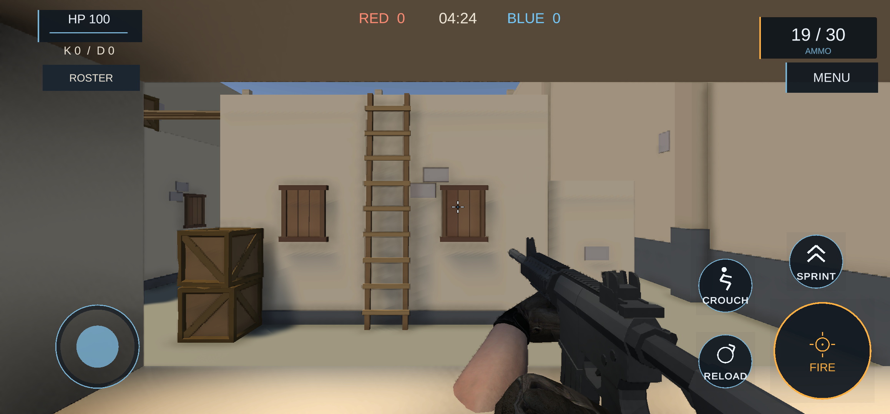
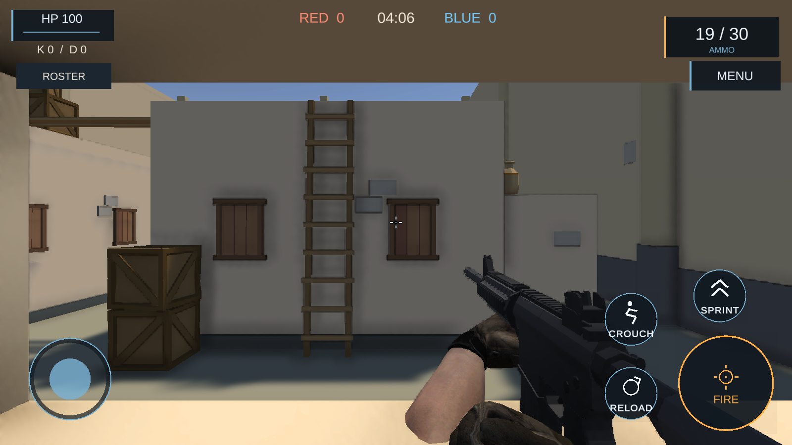

# QA1 두 기기의 사격·이동 터치 해제 관측 — 2026-11-09

관련 #347 / Draft PR348. [앞선 기본 경기](../2026-11-08/localqa-phone-ld-game-flow.md)와 [인트로·실패 기록](../2026-11-08/localqa-followup-bounded-results.md)에 이어, 설치된 LocalQA `1.0.197-qa1`/code1의 제한된 입력 관측을 기록합니다. Samsung SM-N986N과 LD index2가 정상 닉네임·공개 방·READY/START 흐름으로 같은 Game에 들어갔습니다. QA1에는 보행 후보가 없으며 운영 code34/release12·원장196,2,34는 변경하지 않았습니다.

## Native09: 세 모드와 기록 한도

양쪽 기기에서 `single`, `two-fire-up-first`, `two-move-up-first`를 순서대로 각 한 번 실행했습니다. 보조 앱의 주입·정리 성공 6회와 게임 입력 수용은 구분합니다. 게임 QA recorder는 각 PID에서 128행까지만 기록합니다.

두 기기의 태그는 모두 `single`의 Down→Up→중립, 첫 두 손가락 모드의 이동 Down→사격 Down→사격 Up→이동 Up→중립을 담았습니다. 그러나 마지막 `two-move-up-first`는 사격 중인 seq128에서 기록 한도에 도달했습니다. 그 회차만으로 마지막 해제와 중립을 수용하지 않았으며, 이 잘림을 입력 고착의 증거로 해석하지 않았습니다. 태그에 모드명·좌표가 없어 Root의 명시 계획 및 순서와 결속한 결과입니다.

해당 경기에서는 양쪽 5분 DRAW/0:0/TIME EXPIRED, 두 명 DONE, 양쪽 빈 PUBLIC ROOMS 복귀를 확인했습니다. 이 경기 완료 기록과 아래 Native10의 짧은 입력 시험은 별도 회차입니다. Native09 Caller20은65회 중63회 종료0/2회 guard 실패였고, 실패를 성공으로 합산하지 않았습니다. 실제 반환은 UTC15:24:44.428076으로 원 full15:30:14.116339 안입니다.

## Native10: 이동을 먼저 떼는 순서의 별도 재검증

기록 한도에 걸리지 않도록 새 Game/PID에서 `two-move-up-first`만 기기별 한 번 실행했습니다. 게임 APK99,942,564B/SHA256 `17FC62AD4A73E6B3221BD470E2D97AEB84AFCEB29AB2F20ADEAF56DA359C188F`와 helper16,528B/SHA256 `31B7971E51B49C2814CCEACA7F77C98529E05E732DC372890AB331995B7C520E`를 양쪽 기기에서 각각 다시 읽어 일치시켰습니다. 새 설치·빌드·서명은0입니다.

LD RED 호스트 `SFQAld10`과 휴대전화 BLUE `SFQAphone10`이 DesertHouse 방 `SFFQA1109N10`에서 Game에 들어갔습니다. 휴대전화2316×1080/PID20883, LD1600×900/PID7091의 현재 준비 태그를 확인하고, 각 명시 계획의 조이스틱 finger0·사격 finger1 순서로 보조 앱을 실행했습니다. 두 보조 앱 호출은 종료0이었고, 각 게임 태그57행은 seq1..57/err0이었습니다.

| 게임 태그 | 양쪽에서 관측한 상태 |
|---|---|
| seq2 | finger0 시작, 터치1개, 발사·held·capture0 |
| seq20 | finger1 추가, 터치2개, 발사·held·capture1 |
| seq46→47 | finger0 종료 후 finger1만 유지, 발사·held·capture1 |
| seq56 | finger1 종료, 발사·held·capture0, look=-1 |
| seq57 | 터치0개·발사0·held0·capture0의 중립 |

이는 선택한 한 프로필에서 게임의 로컬 입력 상태가 해제 순서를 관측했다는 근거입니다. 실제 네트워크 입력 패킷·수치 yaw·NCC 좌표, 모든 손가락 위치와 기기 조합, 사망·부활/메뉴 전환 중 held-life까지 입증하지 않습니다. 두 기기의 프로필은 순차 실행했습니다.

양쪽 HUD 탄약은30→19였고, 전후 화면의 배경 구성이 달라졌습니다. 실제 좌표 이동을 독립 측정한 것은 아닙니다. HP100/K0/D0은 유지됐으며 명중·피해·처치는 이 시험 범위가 아닙니다.

Caller20은53회 중51회 종료0/2회 실패입니다. 첫 휴대전화 시작은 초기 model guard에서 차단됐고, 별도 PID 조회는 게임 미시작 상태의 `COMMAND_EXIT`였습니다. 실패를 보존한 뒤 Root가 별도 시작을 결정했으며, 실패한 mutation의 자동 replay는0입니다. 최종 zero-payload 서버 관측도 첫 실패와 별도 fresh 성공을 구분했습니다. 서버 재시작·설정 변경은 없었습니다.

이 짧은 회차에서는 경기 종료·결과·로비 복귀를 기다리지 않았습니다. 양쪽 게임 중지·HOME4회는 모두 종료0이었고, prefs1/1·같은 서버760의 현재 연결 peer·호출 부재를 확인한 뒤 private lease와 공개 승인 회수를 기록했습니다. 이는 Root 반납 관측이며 정리 후 PID 부재를 새로 조회한 것은 아닙니다. 원 UTC15:53:29.017195/new16:05:29.017195/full16:08:29.017195를 유지했고, 실제 전체 반환은15:57:05.232299입니다.

## 근거와 남은 범위

외부 검증 기준은 `D:/codex/validation/sudden-force-fps/20261108-work/`입니다. 원시 stdout·private lease·키·APK는 이 문서에 포함하지 않습니다.

- Native09 제한 독립 검토: `native09-actual-bounded-independent-review01/verification.public.json` — SHA256 `E514DC68F30EE2D63E976C82E5D4E064647EF7195CAE5C70D3608A2257135A3C`.
- Native09 표현 정정: `root-resume01/device-case09-view-wording-clarification.public.json` — SHA256 `693F1CC7C79CECA19D242F14AF279DA99CA297CCC936DD5E1503DEAD753ADD5E`. 배경 구성 변화와 실제 좌표 입증을 구분합니다.
- Native10 Root 관측·반환: `root-resume01/device-case10-root-ui-observation01.public.json`, `device-case10-actual-return01.public.json`.
- Native10 실제 결과의 별도 독립 검토: `native10-actual-independent-review01/verification.public.json` —5,308B/SHA256 `871373B73C4EED56B0D399DCBA06A8D1305527238921EC322608136CD0C63B12`. 공개549개·허용 helper stdout2개·추가 허용 원문 archive4개의 총555핀, 태그·화면·원본 회수 기록의 제한된 정합성을 수용했습니다. 현재 기기를 다시 조회한 검토는 아닙니다.

검토 중 허용 목록 밖의0바이트 오류 파일에 크기 메타데이터 조회1건이 발생한 사실도 독립 IR에 남겼습니다. 해당 파일의 내용·해시 읽기는0이며, 이후 정확한 허용 목록으로 한정했습니다. 이를 엄격한 조회 범위 준수로 표시하지 않았고, 검토기 자체의 중단·정정 이력과 게임 시험 실패를 구분했습니다.

세 모드의 모든 실행을 한 번에 검증한 것으로 합치지 않습니다. 기본 이동·사격 입력 및 두 해제 순서의 제한된 관측을 확보했고, held-life·사망/부활·상대 명중·실제 캐릭터 보행·총 파지의 근접 시각 검증·실청·장시간 성능은 남아 있습니다. 현재 필요한 사용자 조치·질문은 없습니다.
