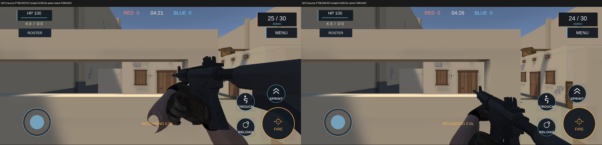

# 재장전 후반 무기 높이 복귀 · #417

QA12 실경기의 재장전 후반에 왼팔 몸통 쪽 열린 단면이 보였습니다. 팔 동작과 yaw/roll은 같은 hand weight로 복귀하지만, 높이의 `0.14 * reloadBlend`는 재장전 상태가 끝날 때까지 남아 있었습니다.

이 후보는 높이에도 `reloadHandWeight`를 곱합니다. 손의 복귀와 함께 무기·팔 전체가 내려가며 phase .97부터 기본 높이로 돌아옵니다. .20–.80의 기존 높이와 탄창 추출 보정은 유지됩니다. 시작 .04–.20의 높이 상승도 같은 곡선을 따릅니다.

## 정적 비교 결과

- Unity 6000.3.25f1, Blue Idle0 복제본, 1280×592, FOV60, near .06, 어깨 보정 .10, 원래 비활성 소매를 유지했습니다.
- phase 0/.80/.82/.84/.86/.88/.90/.92/.94/.96/.98/1 × 기존/후보의 24 PNG를 수집했습니다. 복제본 VM 높이를 수식으로 지정한 비교이며 제품 Locomotion 함수의 실행 검증은 아닙니다.
- 24개 모두 제품 팔 해법과 비교 해법의 78개 본·탄창 행렬 오차0, 중앙40×40 가림0, IK 도달 제한0을 확인했습니다. 손목 위치 잔차 최대0.409µm, 회전 오차0입니다.
- 후보의 원본 팔 경계22점은 12표본 모두 화면 아래에 있습니다. .90/.96의 최소 화면 아래 여유는46.143/17.650px입니다. idle 양쪽은 동일하며 후보 .98/1은 idle과 PNG 바이트까지 같습니다.
- 원본 에셋·입력·시뮬레이션 변환 보존과 cleanup 오류0을 확인했습니다.

실행 자료는 로컬 `20261117-night/qa12-arm-clip-preview01/actual-reload-y-compare-cfab38f120a744c5a0f6cebd12c70903/`, 독립 비교는 `qa12-reload-y-actual-review01/`에 보존했습니다. 원본 어깨 이동 후보들과 소매 활성화 후보는 각각 단면 잔류·시야 가림으로 기각했습니다.

## QA13 실제 Android 확인

같은 제품 C# blob을 QA13 `2b437f8d16a97a2505db4e4415da5a3e90a8ce47`에 반영해 Unity export 오류0·경고4와 Gradle 정상 종료를 확인했습니다. 서명 APK는100,500,560B/SHA256 `4E54DBE520021B154472CB90B5E1219E9878FBE5D7254C4760103B190953F62A`이며, 기존 인증서 v2 서명·359 ZIP payload 동일·네이티브7개 정적 정렬을 확인했습니다.

SM-A175N에서 게임/helper를 QA13으로 보존 업데이트하고 전체 APK의 기기 내부 SHA256·크기, UID·최초 설치 시각·설정4개 유지를 확인했습니다. 폰 QA13과 Editor QA11의 실제 두 피어 경기를 열어 이동·6발·재장전과 탄약30→24→30/HP100을 관측했습니다. 변경한 1인칭 화면은 폰의 QA13입니다. Editor QA11의 표현 코드까지 같은 수정본이었다고 주장하지 않습니다.

- 원본 영상13.9471초/574프레임/9,501,179B의 SHA256은 `4ACC8AB85CC4F5BCE2B3E39713BB773A6536E8AE9EE8342B2E8386E0CF373E0D`입니다. 전체 원본 프레임과 PTS를 보존하고 null 디코드 exit0/error0을 확인했습니다.
- QA13 재장전 중간·후반 대표 원본과6.492456–6.759067초의12연속 프레임에서 QA12의 둥근 열린 팔 끝이 보이지 않고 팔이 화면 아래까지 이어졌습니다. 비교 그림은 HUD0.0초 구간끼리의 비교이며 정확히 같은 animation phase의 pixel A/B는 아닙니다.
- 폰2340×1080 중앙40×40을 영상1280×592에 대응한22×22 정수 cover에서 재장전95연속 프레임의 새 가림을 관측하지 못했습니다.6.791초와 마지막13.925초에 ready/idle 복귀를 확인했습니다.
- 폰·helper·녹화 프로세스를 정리했고 Editor 정상 Exit0/QA define 복귀·원본 공개4136개 바이트/Git clean·공유 ADB 세대 보존으로 반환했습니다.

이 결과는 한 기기·한 화면비·한 재장전 주기의 높이 복귀 수정 수용입니다. 손과 탄창의 표면 접촉은 겹침으로 모호하며 중단 복귀·다른 화면비·모든 조준 자세·전체 제품 품질과 실제16KB 기기 검증은 별도입니다. 실행 근거는 `20261117-resume/afternoon-qa11/run-a9ef4dabf66d4be5ad6895874a0a6bc5/`, 독립 영상 판독은 `20261117-night/qa13-reload-video-review01/`에 보존했습니다. 일반 Play 설치본은 이 QA13 검수 APK로 자동 갱신되지 않습니다.
