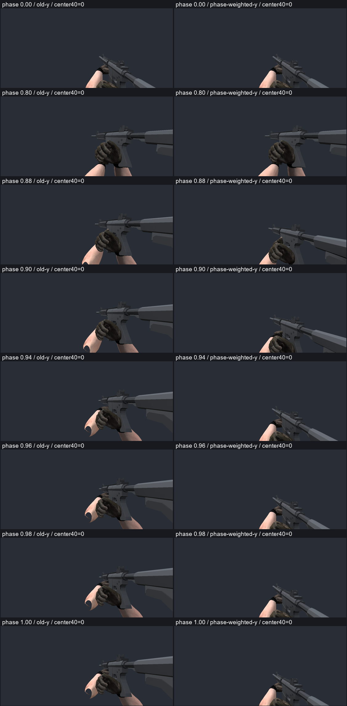

# 재장전 후반 무기 높이 복귀 후보 · #417

QA12 실경기의 재장전 후반에 왼팔 몸통 쪽 열린 단면이 보였습니다. 팔 동작과 yaw/roll은 같은 hand weight로 복귀하지만, 높이의 `0.14 * reloadBlend`는 재장전 상태가 끝날 때까지 남아 있었습니다.

이 후보는 높이에도 `reloadHandWeight`를 곱합니다. 손의 복귀와 함께 무기·팔 전체가 내려가며 phase .97부터 기본 높이로 돌아옵니다. .20–.80의 기존 높이와 탄창 추출 보정은 유지됩니다. 시작 .04–.20의 높이 상승도 같은 곡선을 따릅니다.

## 정적 비교 결과

- Unity 6000.3.25f1, Blue Idle0 복제본, 1280×592, FOV60, near .06, 어깨 보정 .10, 원래 비활성 소매를 유지했습니다.
- phase 0/.80/.82/.84/.86/.88/.90/.92/.94/.96/.98/1 × 기존/후보의 24 PNG를 수집했습니다. 복제본 VM 높이를 수식으로 지정한 비교이며 제품 Locomotion 함수의 실행 검증은 아닙니다.
- 24개 모두 제품 팔 해법과 비교 해법의 78개 본·탄창 행렬 오차0, 중앙40×40 가림0, IK 도달 제한0을 확인했습니다. 손목 위치 잔차 최대0.409µm, 회전 오차0입니다.
- 후보의 원본 팔 경계22점은 12표본 모두 화면 아래에 있습니다. .90/.96의 최소 화면 아래 여유는46.143/17.650px입니다. idle 양쪽은 동일하며 후보 .98/1은 idle과 PNG 바이트까지 같습니다.
- 원본 에셋·입력·시뮬레이션 변환 보존과 cleanup 오류0을 확인했습니다.

실행 자료는 로컬 `20261117-night/qa12-arm-clip-preview01/actual-reload-y-compare-cfab38f120a744c5a0f6cebd12c70903/`, 독립 비교는 `qa12-reload-y-actual-review01/`에 보존했습니다. 원본 어깨 이동 후보들과 소매 활성화 후보는 각각 단면 잔류·시야 가림으로 기각했습니다.

## 후속 확인

수정 제품의 컴파일, 초기 보간·동적 bob·발사/재장전/중단 복귀, Android 실경기 영상은 새 빌드에서 확인합니다. 기존 QA12 설치본은 이 후보를 포함하지 않습니다.
